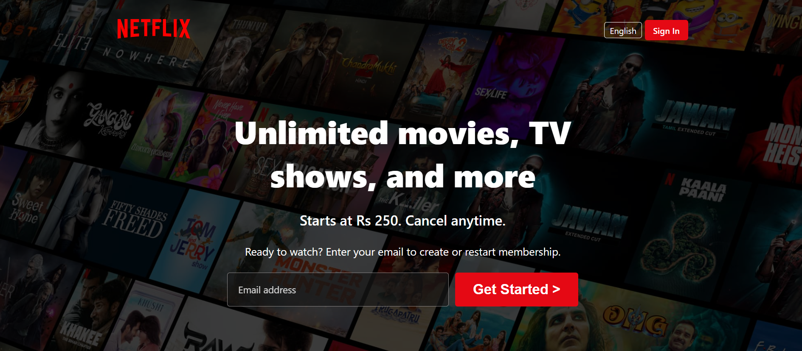

# 🍿 Netflix Clone

A responsive Netflix landing page clone built with semantic HTML5 and CSS3.

## 📸 Screenshot



## ✨ Features

- Responsive layout that adapts to mobile, tablet, and desktop screens
- Hover effects on buttons and movie cards
- Custom-styled scrollbar
- Clean, semantic HTML structure
- Lightweight: pure HTML and CSS, no dependencies

## 🛠️ Built With

- **HTML5**: semantic page structure
- **CSS3**: Flexbox, media queries, transitions, and custom styling

## ⚙️ Getting Started

No installation needed.

1. Clone the repo: 
```bash
git clone https://github.com/aiyu-dev/netflix-clone.git
```
2. Go into the project folder:
```bash
cd netflix-clone
```

You can also open the folder in VS Code and use the Live Server extension.

## 📚 What I Learned

- Building a full page layout from scratch with semantic HTML5
- Making a design responsive with media queries and Flexbox
- Adding hover effects and transitions with CSS
- Styling a custom scrollbar
- Deploying a static site and linking it from GitHub

## 🎓 Credits
This project was built as part of my learning journey,
following the tutorial by [CodeWithHarry](https://www.youtube.com/@CodeWithHarry)
- Customized and extended by me:
    - Built the footer section
    - Made the email input responsive
    - Added other layout and styling improvements
- UI design inspired by [Netflix](https://www.netflix.com) for educational purposes

## ⚠️ Disclaimer

This project is for educational purposes only. It is not affiliated with or endorsed by Netflix.

## 👩‍💻 Author

**Ayesha Shahzad**
Frontend Developer | Computer Science Student

- GitHub: [aiyu-dev](https://github.com/aiyu-dev)

⭐ If you like this project, consider giving it a star!